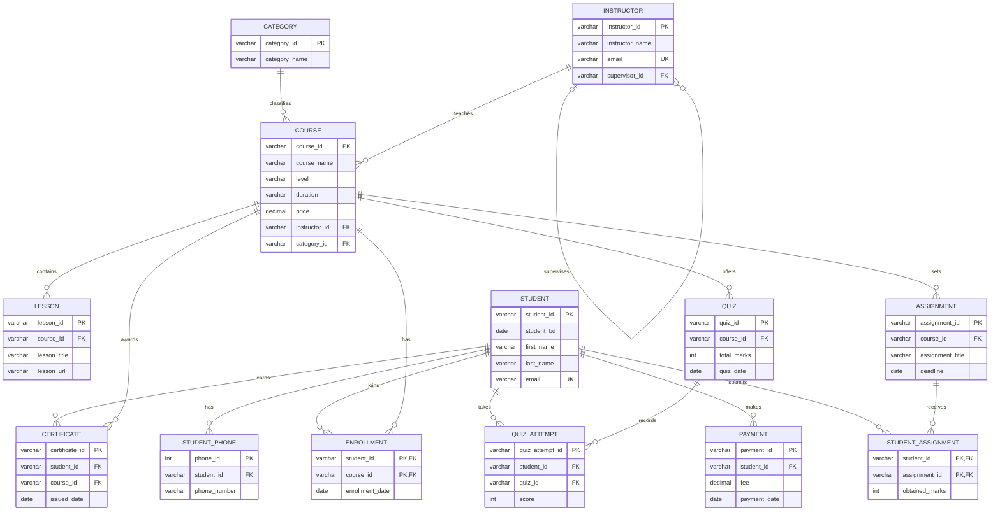

# Entity relationship diagram

This diagram summarizes the tables and foreign keys in `schema.sql`. The associative tables `enrollment`, `student_assignment`, and `quiz_attempt` connect students to learning activity. A student's phones are stored as separate rows.

Primary and foreign keys above follow the current SQL schema. The enrollment primary key is the `(student_id, course_id)` pair, which prevents a duplicate enrollment for the same student and course.
